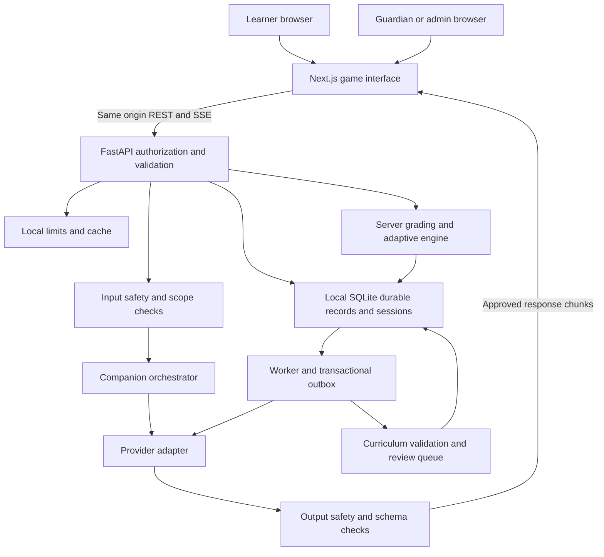

# Cognify architecture proposal

Status: implementation approved; local-only development requested. This document specifies the replacement for the Streamlit prototype. Development proceeds in phased commits. AI credentials and endpoint remain empty throughout development. The current implementation status is recorded in README; planned features below are not claims of completion.

## Product and scope

The learner starts with “What would you like to learn?” and can enter any topic or knowledge goal. Cognify offers a quick explanation or builds a learning world with a path of quests, challenges and companion guidance. Topics can include programming, cooking, music, languages, personal finance, science, history, creative work, career skills and everyday questions. There is no fixed subject whitelist. The application serves children and adults, with age-appropriate presentation and safety controls. Age never determines assumed mastery.

The MVP includes avatar and companion selection, placement per subject, persistent companion identity, quiz battles, ordering and matching puzzles, boss encounters, optional timed rounds, daily quests, XP, coins, streaks, badges, cosmetic purchases, spaced review, and learner and guardian dashboards. Rankings are optional and pseudonymous. Administrators review content and manage operations through separate permissions.

Confirmed scope: India first, open directly to individual learners and families, without school affiliation, enrollment codes, teacher accounts or institutional dashboards. Roles are Learner, Parent/Guardian and Admin. Open access means no institutional membership requirement; authentication and guardian consent gates still apply where required. It does not imply an open-source license or a pricing decision.

Learning is topic-driven and board-independent. Cognify's extensible skill graph models objectives, prerequisites, difficulty and review criteria for each topic. School subjects are examples, not the boundary of the product. No board, grade, occupation or institution is required. Learners can explore a question without taking a placement quiz, or choose a goal and optional starting check for a longer learning path. Familiar Indian contexts can help without assuming language, region or school background. Language coverage remains a separate product decision.

Open topic support does not imply that arbitrary generated material is verified. New requests pass age and safety checks, resolve to existing skills where possible, and otherwise create a draft topic/path for validation. Supported, validated items can award mastery; exploratory explanations identify uncertainty and sources where available. Unverified answers never become authoritative grading keys. Without AI configuration, learners can play curated packs and save requests for new topics, but cannot generate a new course.

## Proposed technology decisions

| Area | Proposal | Reason |
| --- | --- | --- |
| Web | Next.js App Router, TypeScript, Tailwind | Responsive application and reusable typed UI |
| Game presentation | React plus Canvas for effects; Motion for transitions | Keep accessible controls in the DOM; avoid a game engine until mechanics need one |
| Companion | Original SVG character with animated states | No external animation vendor required; replaceable by Rive or Lottie later |
| State | TanStack Query for server data, React state for local controls | Avoid a second global store until needed |
| API | Python FastAPI, Pydantic, SQLAlchemy, Alembic | Reuse reviewed Python learning rules and provide OpenAPI contracts |
| Durable storage | Local SQLite through SQLAlchemy | No database server required for local development; PostgreSQL remains an optional future deployment adapter |
| Ephemeral storage | In-process limits and cache, durable database sessions | No Redis service required for local development; one API process |
| Background work | Database jobs/outbox with a local Python worker | Durable generation and deletion work without an additional queue framework |
| AI | Provider adapter with versioned prompts and JSON schemas | Configurable provider, no mandatory vendor |
| Local development | Python setup and process launcher scripts | Dependencies installed locally; one command starts web and API |
| Delivery | GitHub Actions and native application builds | No Docker; hosting choice deferred until deployment approval |

Exact dependency versions are selected and locked in Phase 1 after compatibility checks. Deployment, OAuth and verification services are not provisioned by this proposal.

## System diagram



Use REST for actions and SSE for companion replies; WebSockets are unnecessary for the proposed single-player MVP. Browsers never receive provider credentials or unreleased answer keys. All progress and economic changes are server decisions.

## Domain boundaries and data model

Auth owns accounts, sessions and roles; users owns learner profiles and guardian relationships; companion owns character configuration and bounded educational memory; content owns curriculum and published challenges; progress owns attempts, evidence and review schedules; gamification owns rewards and inventory; analytics owns consent-aware activity aggregates. Each domain exposes services; API routes do not implement learning rules.

```mermaid
erDiagram
  ACCOUNT ||--o{ ROLE_GRANT : holds
  ACCOUNT ||--o{ SESSION : opens
  ACCOUNT ||--o{ GUARDIAN_LINK : manages
  LEARNER ||--o{ GUARDIAN_LINK : protected_by
  GUARDIAN_LINK ||--o{ CONSENT_RECORD : records
  LEARNER ||--|| COMPANION : selects
  COMPANION ||--o{ MEMORY_FACT : remembers
  LEARNER ||--o{ CHAT_THREAD : opens
  CHAT_THREAD ||--o{ CHAT_MESSAGE : contains
  TOPIC ||--o{ SKILL : includes
  SKILL ||--o{ SKILL_PREREQUISITE : depends_on
  TOPIC ||--o{ WORLD : hosts
  LEARNER ||--o{ LEARNING_GOAL : chooses
  TOPIC ||--o{ LEARNING_GOAL : concerns
  LEARNING_GOAL ||--o{ LEARNING_PATH : develops
  LEARNING_PATH ||--o{ QUEST : sequences
  LEARNER ||--o{ TOPIC_REQUEST : proposes
  TOPIC ||--o{ SOURCE_REFERENCE : supported_by
  WORLD ||--o{ LEVEL : contains
  LEVEL ||--o{ QUEST : offers
  QUEST ||--o{ QUEST_CHALLENGE : contains
  CHALLENGE_VERSION ||--o{ QUEST_CHALLENGE : supplies
  CHALLENGE_VERSION ||--o{ CHALLENGE_SKILL : assesses
  SKILL ||--o{ CHALLENGE_SKILL : mapped_to
  LEARNER ||--o{ ATTEMPT : plays
  CHALLENGE_VERSION ||--o{ ATTEMPT : snapshots
  ATTEMPT ||--o{ RESPONSE : records
  LEARNER ||--o{ MASTERY : develops
  SKILL ||--o{ MASTERY : measures
  LEARNER ||--o{ REVIEW_SCHEDULE : receives
  SKILL ||--o{ REVIEW_SCHEDULE : revisits
  ATTEMPT ||--o{ REWARD_ENTRY : earns
  LEARNER ||--o{ REWARD_ENTRY : owns
  LEARNER ||--o{ INVENTORY_ITEM : collects
  COSMETIC ||--o{ INVENTORY_ITEM : grants
  LEARNER ||--o{ BADGE_AWARD : earns
  LEARNER ||--o{ DAILY_QUEST : receives
  LEARNER ||--o{ ACTIVITY_INTERVAL : records
  LEARNER ||--o{ LEADERBOARD_ENROLLMENT : opts_in
  LEARNER ||--o{ AI_USAGE : consumes
```



All durable records use UUIDs and UTC timestamps. Accounts hold adult email and password hash or verified OAuth subject. Child profiles use a generated alias, age band, avatar, guardian link, locale and accessibility preferences; child email and exact birthday are not requested by the companion. Adult learners link to their own accounts.

Key fields and constraints:

- Consent records: guardian link, purpose, policy version, verification reference, grant/revocation timestamps. A checkbox alone is not treated as verified parental consent.
- Companion: learner ID unique, character ID, chosen safe name and personality preset. Memory facts contain approved skill IDs, preferences and progress summaries, with provenance and expiration; arbitrary chat is not automatically promoted to memory.
- Challenge versions: curriculum/version, age band, skill mapping, difficulty, mechanic, public payload, private answer key, explanation, validation and publication status. Published versions are immutable; attempts pin a version.
- Attempts: learner, challenge version, state, server start/end time, difficulty, hint usage. Responses have unique attempt and sequence numbers. State transitions reject duplicate or out-of-order completion.
- Mastery: unique learner and skill, distinct evidence count, estimated proficiency and model version. Review schedules include next due time and last evidence ID.
- Reward entries: learner, currency, signed amount, source, unique event key. Reward issuance and attempt completion commit together. Cosmetic purchases debit coins and grant inventory in one transaction with a balance check and idempotency key. Coins have no cash value or paid purchase path in the MVP.
- Activity intervals: server-bounded active durations with idle exclusion and capped heartbeats, not total browser-open time. AI usage records actual provider-reported tokens, latency, model and pricing version; unknown costs remain unknown.
- Additional operational tables: idempotency records, audit events, content reviews, background jobs and transactional outbox. Redis rankings and cached balances are rebuildable from durable records.

## API contract

Base path `/api/v1`. JSON request/response schemas generate the TypeScript client from OpenAPI. Secure HttpOnly SameSite cookies carry sessions; state-changing requests require CSRF protection and origin validation. Every learner-resource endpoint checks relationship and role on the server.

| Method and route | Request or purpose | Response |
| --- | --- | --- |
| POST /auth/register | Adult email and password | 201 account with pending verification |
| POST /auth/login | Credentials | 200 account and session cookie |
| POST /auth/logout | Revoke current session | 204 |
| GET /me | Session identity and capabilities | 200 account |
| POST /learners | Alias, age band, avatar, companion | 201 learner and consent state |
| POST /learners/{id}/consents | Purpose, version, verification reference | 201 verified or pending record |
| DELETE /learners/{id}/consents/{consentId} | Revoke authorization | 204; invalidate gated access |
| POST /learners/{id}/placement | Topic ID | 201 placement attempt |
| POST /learners/{id}/topic-requests | Free-text topic, goal, optional experience and preferred depth | 202 validation/generation job or 200 existing topic |
| GET /topic-requests/{id} | Authorized request status | 200 status, topic/path or safe explanation of limits |
| GET /topics | Search text, cursor and limit | 200 discoverable topics; not an admission whitelist |
| POST /learners/{id}/learning-paths | Topic ID, goal and optional starting level | 202 path creation job |
| GET /learners/{id}/worlds | Worlds, levels, locked-state reasons | 200 map |
| GET /learners/{id}/quests | Cursor, limit, topic, due filter | 200 items and next cursor |
| POST /learners/{id}/attempts | Quest/challenge ID | 201 attempt and public challenge |
| POST /attempts/{id}/responses | Sequence, answer, idempotency key | 200 feedback, next challenge, rewards |
| POST /attempts/{id}/hints | Hint tier | 200 approved hint without answer |
| POST /learners/{id}/chat/streams | Skill ID, message, request ID | SSE events |
| GET /learners/{id}/companion | Character, equipped cosmetics | 200 companion |
| PATCH /learners/{id}/companion | Allowed name, personality, equipment | 200 companion |
| GET /learners/{id}/rewards | Cursor and limit | 200 ledger |
| POST /learners/{id}/purchases | Cosmetic ID, idempotency key | 201 inventory and balance |
| POST /learners/{id}/leaderboard-enrollment | Opt-in and authorized scope | 201 enrollment |
| DELETE /learners/{id}/leaderboard-enrollment | Withdraw | 204 |
| GET /leaderboards/{scope} | Cursor and limit | 200 aliases and bounded rankings |
| POST /learners/{id}/activity | Session ID and monotonic heartbeat | 202 |
| GET /learners/{id}/progress | Topic and bounded date range | 200 mastery, reviews, active time |
| POST /privacy/exports | Authorized account/profile scope | 202 job |
| DELETE /learners/{id} | Authorized deletion request | 202 job |
| POST /admin/content/generations | Curriculum ID and validated specification | 202 job |
| POST /admin/content/{versionId}/publish | Approved review reference | 200 published version |
| GET /health/live and /health/ready | Liveness and dependency readiness | 200 or 503 |

Example answer submission:

```json
{"sequence": 2, "answer": {"optionId": "option-b"}, "idempotencyKey": "client-generated-uuid"}
```

```json
{"correct": true, "attemptState": "completed", "feedback": "Three equal parts out of four.", "rewards": [{"currency": "xp", "amount": 20}], "nextQuestId": "quest-uuid"}
```

Repeated identical requests return the recorded result; reusing a key with a different body returns 409. Missing authorization returns 401; inaccessible resources return 404 to avoid disclosure; invalid data returns 422; throttling returns 429 with Retry-After. Errors use `{error: {code, message, requestId}}`. Lists use opaque cursors, default 20 and maximum 100 items.

SSE event types: `status`, `approved_chunk`, `hint`, `done`, `error`. Event IDs allow safe reconnect without duplicate messages or provider calls. Raw model tokens are never forwarded to children: output is buffered into moderated units before release. The first approved chunk target is measured separately from raw provider token latency; safety gates can make the requested 1.5-second target infeasible for a provider. The UI displays a thinking state immediately.

## Learning and game design

Each learning path has a themed world map. A quest lasts approximately 3–5 minutes and mixes previously learned skills with a new challenge. Quiz battles convert correct reasoning into shield or attack actions; puzzle games use matching tiles and ordered paths; bosses combine several previously practiced skills. Match mechanics to the topic: sequencing a recipe, debugging a program, recognizing a musical pattern or practicing a conversation. Practical or creative work uses explicit rubrics and reflection; self-reported completion earns participation rewards rather than verified mastery. Optional timed rounds award cosmetic achievements, not penalties to mastery. Provide untimed equivalents and pause/resume. No purchasable advantages, streak-loss penalties or public chat.

The companion animates idle, thinking, hinting, celebrating and encouraging states. Sound starts only after user interaction, with a persistent mute preference. Reduced-motion mode removes camera movement and particles. Every canvas mechanic has equivalent keyboard and touch controls with a readable DOM description and live result announcements.

Adaptive decisions use placement evidence, recent distinct questions, hint usage and delayed recall. Start with an interpretable, versioned rules engine. Update mastery after each graded response; choose the next difficulty within bounded steps and schedule spaced review. Repeated attempts on the same item do not manufacture mastery. Time pressure is not an ability signal. Evaluate calibration with seeded fixtures and representative learner histories before tuning.

Daily quests default to Asia/Kolkata for the India launch, with a documented timezone-change policy to prevent duplicate daily rewards. Leaderboards are off by default, group opted-in learners into small system-assigned challenge groups, show generated aliases, cap daily ranking points, and offer personal-best goals. These groups have no school affiliation, messaging or profile discovery. Child participation requires guardian authorization.

## AI content and safety architecture

An adapter supports structured generation, tutoring, streaming, moderation capabilities and usage reporting. Prompts and schemas are versioned. Provider access is server-only with timeout, cancellation, bounded retries, per-learner usage limits and circuit breaking. Cache keys include curriculum, prompt version, age band, skill and locale; personal chat caches are private and short-lived.

Content schema includes topic, framework version, objectives, skill IDs, optional external standards, source references, age band, prerequisites, difficulty, mechanic payload, grading method, private answer key or rubric, explanation and hint ladder. Validation checks structure, skill mapping, answer consistency, age suitability and moderation. Deterministic verifiers are used where possible; remaining assessed material requires review before publication. Schema validity alone does not establish factual accuracy. Time-sensitive topics require current sources and freshness metadata; unavailable verification is disclosed rather than invented. The generation worker tracks draft, validated, review-required, published and rejected states.

The companion answers educational questions across topics and supports switching goals; a new topic is not refused merely because it differs from the active lesson. It explains directly in exploration mode and uses a bounded hint ladder during active assessed challenges. Incoming and outgoing content passes age-appropriate safety, privacy and injection checks. Dangerous requests receive safe alternatives; sensitive domains support general education with appropriate limits. Retrieved sources are untrusted data, never instructions. Retrieval is server-controlled with source provenance and network restrictions. The companion has no unrestricted database or tool access. Output checks prevent personal-data solicitation and answer leakage in active challenges. No tools execute instructions from model output.

Without configured AI, the application runs real curated lessons, deterministic grading and authored companion hints, clearly labeled as guided mode. It does not fabricate generated responses or usage metrics. Missing required production moderation capability disables online AI rather than bypassing checks.

## Privacy and authorization gates

India is the initial release jurisdiction. Applicable India DPDP requirements, commencement timelines, age policies, consent verification and provider arrangements must be reviewed before real children are onboarded. This architecture is not a claim of legal compliance. COPPA and GDPR-K assessments become expansion gates if US or European markets are introduced; India-first deployment does not itself settle obligations arising from international availability.

Guardian accounts manage child access, AI permission, ranking permission, export, revocation and deletion. There are no teacher or school access paths. Admin capabilities are individually granted and audited. Logs exclude credentials, raw prompts, child aliases and message text. Monitoring is self-hostable or configured to scrub personal data before export.

Retention durations, export availability, deletion schedules, backup expiration and region residency are explicit configuration and release-policy decisions. Raw chat retention and long-term educational memory are separate. Revocation invalidates active sessions and pending AI work. Deletion jobs cover PostgreSQL, Redis, exports and provider records where supported, with backup expiration documented.

## UI and accessibility

Design tokens define palette, spacing, radius, typography and elevation for dark and light modes. The reusable library includes buttons, inputs, dialogs, map nodes, quest cards, meters, companion panels, reward overlays, loaders and game controls, documented in Storybook. Use readable rounded typography with an optional dyslexia-friendly preference.

Target WCAG 2.2 AA through keyboard testing, visible focus, contrast checks, touch target sizing, screen-reader announcements and reduced motion. Never communicate correctness solely with color or sound. Verify responsiveness at narrow mobile, tablet and desktop sizes. Treat 60fps as a measured animation target on agreed devices, not a guarantee for all hardware.

Optimistic updates apply to reversible preferences; rewards and purchases wait for server acknowledgement. Offline mode caches approved public lessons and allows unscored practice. Progress writes require reconnection and server validation; private child records are not cached in a shared service-worker cache.

## Proposed repository structure

```text
apps/
  web/src/{app,components,features,games,lib,styles}/
  api/app/
    domains/{auth,users,companion,content,progress,gamification,analytics}/
    infrastructure/{database,redis,llm,observability}/
    api/v1/
    worker/
  api/migrations/
packages/
  api-client/
  ui/
content/{topics,skill-graphs,starter-packs,validators}/
prompts/{companion,content,moderation}/
schemas/
tests/{unit,integration,e2e,load,safety}/
docs/{architecture,operations,privacy}/
scripts/
.github/workflows/
scripts/dev.py
scripts/setup.py
.env.example
README.md
```

Keep the existing Streamlit implementation until replacement acceptance. Port learning rules only after tests establish their behavior. Map existing math, science and computing records to corresponding topics without changing their meaning. Any migration of real accounts requires a separate reviewed mapping and backup plan.

## Configuration and local run

The new configuration template will contain blank values:

```dotenv
AI_PROVIDER=
AI_API_KEY=
AI_ENDPOINT=
AI_MODEL=
AI_ENABLED=false
MODERATION_PROVIDER=
MODERATION_API_KEY=
MODERATION_ENDPOINT=
```

No default remote endpoint, embedded key, automatic provider request or credential-file discovery is used in the replacement. AI is explicitly enabled only after configuration and safety readiness checks pass. Existing prototype configuration is unchanged during architecture review.

Local commands: run `python scripts/setup.py` once, then `python scripts/dev.py`. The launcher starts Next.js and FastAPI directly, stores data in local SQLite and stops both processes on Ctrl+C. No container runtime or database service is required. Planned seed packs span academic, practical and creative topics without restricting topic entry. README and setup scripts explain prerequisites, ports and later AI configuration. Secrets are supplied externally and never committed.

## Quality and acceptance

Core domains require at least 80% branch and line coverage, enforced in CI. Unit tests cover grading, hint behavior, difficulty, review intervals and rewards; PostgreSQL/Redis integration tests cover ownership, consent revocation, concurrent purchases, idempotency and deletion. Playwright tests cover onboarding, all game modes, guardian access, keyboard operation, reduced motion, offline recovery and error states. Safety tests cover injections, personal data, off-topic requests, answer leakage and blocked outputs.

Performance gates measure p95 non-LLM API latency below 300ms under a documented dataset, concurrency and hosting profile. Measure first approved AI response separately, aiming below 1.5s where moderation and provider performance allow. Load tests, tracing and query budgets establish whether those targets are met. CI includes lint/type checks, migrations, coverage, integration/E2E tests, dependency scanning and container builds. No deployment occurs until target infrastructure and production policies are approved.

## Phased roadmap

| Phase | Deliverables | Exit gate and commit |
| --- | --- | --- |
| 1 Foundation | Repository layout, typed web/API, tokens, local launcher, SQLite, migrations, OpenAPI, CI, README and blank AI configuration | One-command guided startup; health checks and CI pass; foundation commit |
| 2 Auth and onboarding | Adult auth, role/ownership checks, guardian relationships, consent states, avatar/companion selection, free-text learning goals and optional topic placement | Cross-account access tests, consent gating and onboarding E2E; onboarding commit |
| 3 Companion | Persistent identity/memory, provider adapter, topic discovery and path generation, source provenance, versioned prompts, hints, moderated SSE, quotas/cache/usage | Guided mode works with no credentials; novel-topic requests, safe topic switching, validation gates and adapter contract tests pass; companion commit |
| 4 Gamification | Worlds, levels, quests, four game modes, reward ledger, coins/shop, badges, daily quests, approved opt-in rankings | Gameplay E2E, keyboard equivalents and concurrent reward/purchase tests; gamification commit |
| 5 Adaptive learning | Skill graph, real-time difficulty, evidence-based mastery and spaced review | Deterministic evidence fixtures, duplicate-item safeguards and review tests; adaptive commit |
| 6 Dashboards | Learner and guardian views, active-time aggregation, skills, review recommendations, export/deletion | Aggregate accuracy, ownership and privacy job tests; dashboard commit |
| 7 Polish and deployment | Animation/sound, themes, accessibility, Storybook, loaders, offline behavior, operations guide and deployment manifests | Coverage, accessibility, performance and E2E gates; approved hosting release; polish commit |

Each phase records tests and remaining limits in its commit. No placeholder AI is presented as real generation. Live AI integration and production consent verification remain explicitly unverified until the user supplies credentials and approved services.

## Decisions required before implementation

India-first launch, open-topic learning for all ages and direct individual/family access with no teachers or schools are confirmed. Implementation is approved with Next.js, FastAPI and a Docker-free local setup. SQLite is the local default; external services are optional future deployment choices. The skill framework and initial skill-pack inventory will be explicit implementation artifacts, with no board affiliation, grade-based admission restriction or fixed subject whitelist.

The parental verification approach must be approved before production consent implementation. Email/password is proposed for adult accounts; select any OAuth providers if required at launch. Launch language coverage, hosting, data residency and retention policy can be approved before their dependent phases. Until resolved, use synthetic demo data only for those flows. AI key and endpoint remain blank during development as requested.
